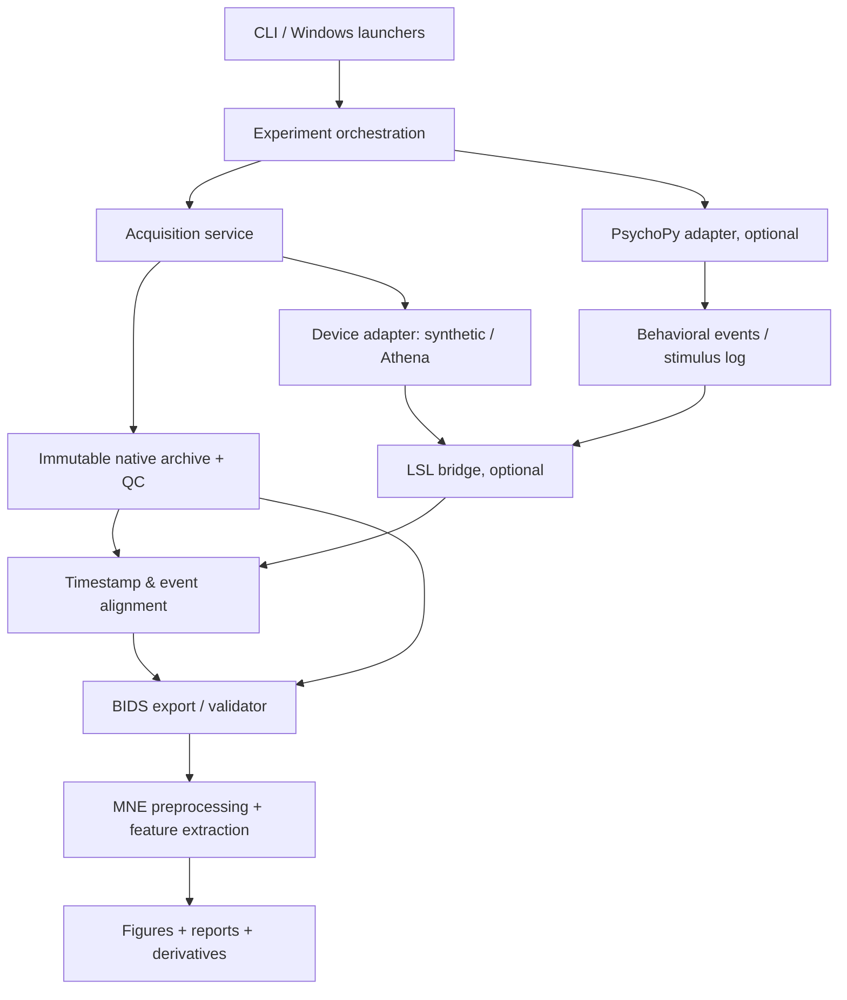

# EEG Neurolyze: project concept and system architecture

**Status:** żywa architektura; stan implementacji zweryfikowany względem kodu 2026-10-31. **Canonical repository:** `MatPomGit/eeg-neurolyze`. **Code package:** `eeg_athenalyze` (legacy import name, not a second product). English is the default implementation language; student materials are maintained in English and Polish.

## 1. Purpose, boundaries and users
EEG Neurolyze is a Windows 11-first, local-first research and teaching platform connecting EEG acquisition, configurable neuropsychological experiments, behavioral response collection, scientific processing, EEG-BIDS exports and reproducible reports. Initial hardware is Muse S Athena; synthetic EEG is the hardware-free teaching and testing source. Researchers need reliable provenance and data preservation; students need guided one-click procedures; developers need stable interfaces for adding devices, protocols and algorithms.

**In scope:** nonclinical resting-state EEG, block experiments, PsychoPy-based cognitive tasks, quality assessment, MNE analyses, BIDS packaging and validation, bilingual learning materials. **Out of scope for the initial release:** diagnosis, medical claims, verified ERP/BCI timing accuracy, cloud upload of participant data, arbitrary-device compatibility, clinical electrode localization and online closed-loop stimulation. Advanced BCI, ERP and neurofeedback are roadmap items, gated by validation.

## 2. Current evidence-based implementation status
As inspected on main: `src/eeg_athenalyze/recording.py` implements synthetic EEG; `archive.py` stores checksummed `.eegz` archives; `experiments/eyes_open_closed.py` generates EO/EC events; `analysis/spectral.py` computes resting spectral summaries; `reporting/html_report.py` creates HTML; `cli.py` exposes synthetic recording/experiment and offline analysis. Tests are present. Windows .bat launchers and EN/PL quickstarts are present. **Implemented code beyond original M01:** a guarded physical Athena adapter and CLI (`muse_athena.py`, `cli.py`), synthetic-only EEG-BIDS BrainVision export and official validator invocation (`bids.py`), custom derivatives (`derivatives.py`), offline device diagnostics and QC. The presence of code does not prove qualified on-device sampling, verified source timestamps, real-session BIDS readiness or clinical validity. **Still planned/unverified:** PsychoPy, LSL/XDF integration, precise stimulus timing, validated physical Athena end-to-end experiments and full experiment registry. Re-check evidence in CI and device issues before changing validation status.

## 3. Logical architecture

Acquisition and PsychoPy may be separate local processes with explicit startup/stop coordination. LSL does not magically correct Bluetooth transport latency. Preserve source timestamps, clock domains, synchronization uncertainty and real recording interruptions. The orchestrator manages state, never performs DSP directly.

## 4. Domain model and lifecycle
Typed versioned contracts: `DeviceCapabilities`, `ChannelDescriptor`, `AcquisitionChunk`, `ClockObservation`, `Recording`, `Session`, `ExperimentDefinition`, `Block`, `Trial`, `Event`, `QualityReport`, `ProcessingRun`, `BidsExportReport`. Every event must have stable event ID, trial/block IDs where applicable, condition, event type, timestamp, time domain, duration, and optional response/outcome. Separate actual stimulus onset from planned onset and from frame-synchronous callback timestamps.

Session state machine: CREATED → ENVIRONMENT_CHECKED → DEVICE_READY → RECORDING → FINALIZING → ARCHIVED → QC_REVIEWED → EXPORTED → VALIDATED → ANALYZED → REPORTED. FAILED/INTERRUPTED must preserve partial source and diagnostics. No automatic reacquisition during offline reruns; no silent synthetic fallback. A valid run can be incomplete scientifically even if the process exits successfully.

## 5. Acquisition and hardware strategy
An adapter protocol should provide capability discovery, open/start/read/stop/close and explicit diagnostics. Muse uses BrainFlow's Athena board identity, with mappings, units, reference and timestamps verified against runtime API and physical hardware. Four primary electrodes are TP9, AF7, AF8, TP10; do not describe extra preset fields as new independent scalp electrodes. Synthetic generator provides seeded controlled alpha differences, artifacts and deterministic timestamps; always label simulated output.

Store all available native channels and auxiliary streams independently. Record sampling frequency, packet continuity evidence, timestamp provenance, sample counts, gaps, version metadata and QC. A device-ready message is not equivalent to successful acquisition.

## 6. Experimental engine and PsychoPy
Experiment definitions are versioned, validated YAML plus optional Python protocol implementations. The registry must refuse incomplete experimental plugins. Headless protocols (EO/EC) run without PsychoPy. PsychoPy Builder `.psyexp` templates serve students; PsychoPy Python API serves dynamic paradigms. Planned cognitive reference tasks: Stroop and N-back; future: oddball, Go/No-Go, CPT, affective tasks and cautiously designed BCI. Each task declares instructions (PL/EN), stimuli, counterbalancing, trials, response channels, timing parameters, expected EEG features and behavioral outputs.

PsychoPy runs in a separately verified Python environment. Its visual-frame callbacks should emit trial/stimulus event markers via a well-defined LSL transport. LSL streams can be recorded as XDF when appropriate, alongside immutable native EEG. Event alignment and latency metrics are first-class deliverables, not assumptions.

## 7. Persistence contract and BIDS
**Source-of-truth:** immutable native acquisition archive with SHA-256 manifest and read-back check; interrupted acquisition is explicitly marked. Versioned derivative runs never overwrite source. **Interoperability output:** MNE-BIDS export in a BIDS-allowed EEG format, initially BrainVision, with verified channel units/reference, acquisition and task metadata, event-relative onsets and accurate participant pseudonyms. Do not fabricate electrode positions or source timing. Only call output BIDS-compliant after running the official BIDS Validator with no blocking errors. Keep validator version/report. Validate export round-trip using MNE: sample count, channels, sampling rate, numerical tolerance and events. Raw EEG and BIDS Derivatives stay distinct; custom derivatives document their scope and provenance. Use dataset-specific `dataset_description.json` and accurate `GeneratedBy` for derivatives.

Example local organization (the source archive is **not** itself BIDS):
```text
data/local/sessions/<session-id>/source.eegz
data/local/sessions/<session-id>/events.jsonl
data/local/sessions/<session-id>/provenance.json
data/bids/<dataset>/dataset_description.json
data/bids/<dataset>/sub-<id>/ses-<id>/eeg/...
data/bids/<dataset>/derivatives/eeg-neurolyze/...
```

## 8. Analysis and interpretation
Preprocessing profiles must document channel selection, units (BrainFlow µV vs MNE V), reference, filter bandwidth/phase/edges, discontinuities, rejection criteria, epoch definitions and QC before computing summaries. Welch PSD and absolute/relative band powers are first targets. The EO/EC alpha effect is demonstrable synthetically but has limited physiological sensitivity without occipital electrodes. Do not use ICA by default for four channels or infer neuropsychological diagnoses from single-band amplitudes. Separate exploratory and confirmatory claims and mark a lack of adequate epochs clearly.

## 9. Execution environments and deployment
Windows 11 first. Core .venv targets Python 3.12; PsychoPy .venv-psychopy targets a separately verified compatible interpreter (initially 3.11). Dependency constraints must be locked/reproducible when implemented. .bat scripts only delegate to versioned Python CLI; no global package installs, silent upgrades or implicit admin rights. Design optional alternative Standalone PsychoPy integration. Windows and Ubuntu CI run synthetic tests only; physical BLE tests are opt-in.

## 10. Quality, privacy, ethics and security
Tests: unit model/validation; synthetic end-to-end; crash/recovery; source integrity; event alignment; BIDS validator/read-back; PsychoPy stimulus timing in simulation; Windows paths with spaces; integration/hardware opt-in. Use PEP 8, type annotations, Ruff, Mypy, Pytest as dependencies are introduced. Adopt least privilege CI; never run untrusted PR code on persistent self-hosted runners. Pseudonymize IDs, separate contact data, prevent Git/cloud upload, control sharing and date shifting, and avoid logs with participant identifiers. Human-subject ethics/consent is external to the software.

## 11. Education and UX
One-click setup, simulator and analysis entry points; always disclose simulated vs measured. Six target laboratories, each bilingual: acquisition, preprocessing, spectral analysis, EO/EC, PsychoPy experiments, BIDS/reproducibility. Every tutorial includes prerequisites, exact commands, theory, expected artifacts, troubleshooting, methodological caveats and references. Only document commands that exist. Docs website and English/Polish README should show implemented vs planned features separately.

## 12. Nonfunctional requirements
Repeatability: configuration snapshots + seeds + package/commit versions. Observability: structured logs and stage statuses. Robustness: bounded memory buffers, clean shutdown, replay-safe reporting. Portability: OS paths managed by pathlib, versioned interfaces, no hardcoded machines. Scientific traceability: immutable source → validated conversion → versioned derivatives. Accessibility: plain-language error messages; Polish and English teaching parity. Performance targets only after measurement, never fabricated.

## 13. Release and governance
See [roadmap](ROADMAP.md) and [ADR index](adr/README.md). Each milestone has acceptance gates and evidence. PRs must identify runtime/tests/docs impact, migration plan, risk and actual results. Architectural changes require a new ADR, not rewriting an accepted historical decision. License compatibility of bundled PsychoPy and other dependencies must be reviewed before redistribution.
