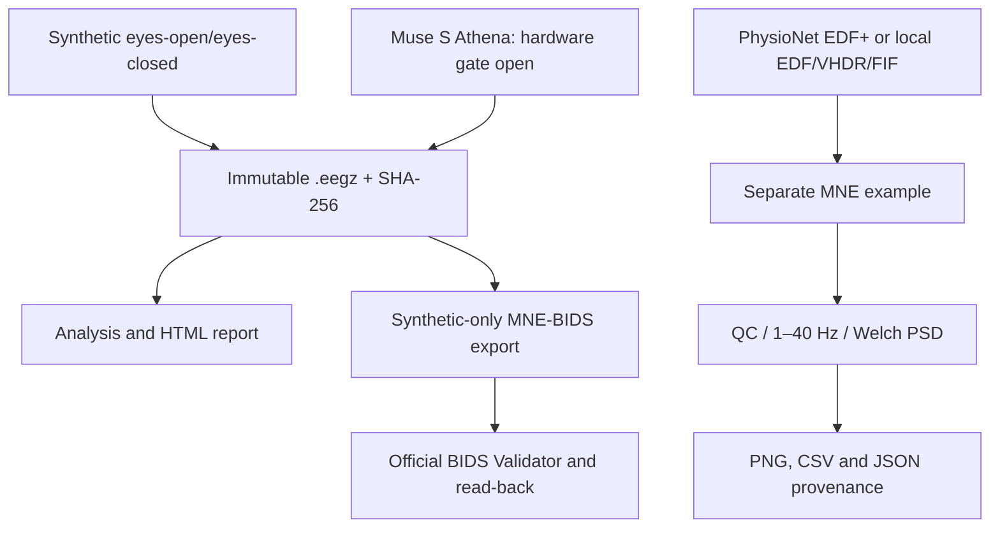

# Acquisition and analysis architecture

EEG Neurolyze separates signal acquisition, immutable archives, preprocessing, and verifiable reports.

## Reproducibility layers

| Layer | Content | Requirement |
|---|---|---|
| Raw | EEG samples, timestamps, event source | Preserve original, never overwrite |
| Context | channel names, units, reference and sample rate | Document unknown values, do not invent |
| QC | channel integrity, artifact screening, time gaps | Explain and log exclusions |
| Analysis | filters, Welch PSD, alpha (8–13 Hz) | Log exact choices and library versions |
| Reporting | PNG, CSV, JSON / checksum and source citations | Differentiate simulation from empirical data |

The application’s BIDS exporter does **not** accept arbitrary measured recordings. The independent PhysioNet pipeline does not validate the Muse device or replace a full artifact-removal workflow.

See [real data](real-eeg.md), [quality gates](quality.md), and [project architecture](../architecture/PROJECT-CONCEPT.md).
