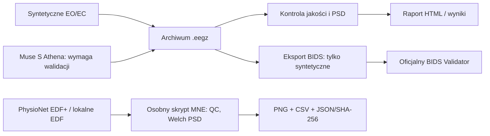

# EEG Neurolyze

**EEG Neurolyze** to lokalny zestaw narzędzi do rejestracji, archiwizacji, kontroli jakości i analizy EEG oraz przygotowywania danych w standardzie EEG-BIDS. Kod Pythona nadal używa historycznych nazw `eeg_athenalyze` i `eeg-athenalyze` (ADR-0006).

[Przewodnik po polsku](pl/index.md) · [English documentation](en/index.md) · [Repozytorium](https://github.com/MatPomGit/eeg-neurolyze)

## Od źródła sygnału do odtwarzalnego wyniku

!!! warning "Rozróżnienie statusów"
    Działający kod, przejście testów automatycznych i pomyślny pomiar sprzętowy to trzy różne poziomy dowodów. Eksport `.eegz` → BIDS dotyczy obecnie **danych syntetycznych**. Demonstracja PhysioNet jest osobnym przykładem MNE. Nie traktuj wygenerowanych danych jako empirycznych.

## Najważniejsze działy

| Zakres | Polski | English |
|---|---|---|
| Instalacja i pierwsza analiza | [Szybki start](pl/quickstart.md) | [Quick start](en/quickstart.md) |
| Rejestracja i przepływ danych | [Architektura](pl/workflow.md) | [Workflow](en/workflow.md) |
| EEG-BIDS | [Eksport i walidacja](pl/bids.md) | [BIDS export](en/bids.md) |
| Rzeczywiste EEG | [PhysioNet i lokalne dane](pl/real-eeg.md) | [Real EEG](en/real-eeg.md) |
| Walidacja sprzętu | [Muse S Athena](pl/muse-athena.md) | [Muse S Athena](en/muse-athena.md) |
| Status projektu | [Roadmap](architecture/ROADMAP.md) | [ADRs](architecture/adr/README.md) |

**Aktualizacja dokumentacji:** 2026-10-31. Materiały opisują możliwości oprogramowania i ograniczenia, nie oferują diagnozy medycznej.

## Rozwój projektu i autonomiczni agenci

- [Cykl pracy agentów](development/agent-workflow.md), [obsługa Issues](issue-operating-procedure.md), [testy i CI](development/testing.md).
- [Standardy kodu](development/coding-standards.md), [języka](development/writing-standards.md), [budżety dokumentacji](development/document-budgets.md).
- [Reprodukowalność badań](research/reproducibility.md), [terminologia EEG](glossary.md), [dydaktyka](teaching-standards.md).

Instrukcja główna dla agentów jest w [AGENTS.md na GitHub](https://github.com/MatPomGit/eeg-neurolyze/blob/main/AGENTS.md); wejście dla użytkownika w [README](https://github.com/MatPomGit/eeg-neurolyze/blob/main/README.md). Dokumenty szczegółowe mają odnośniki zwrotne do tego indeksu.
