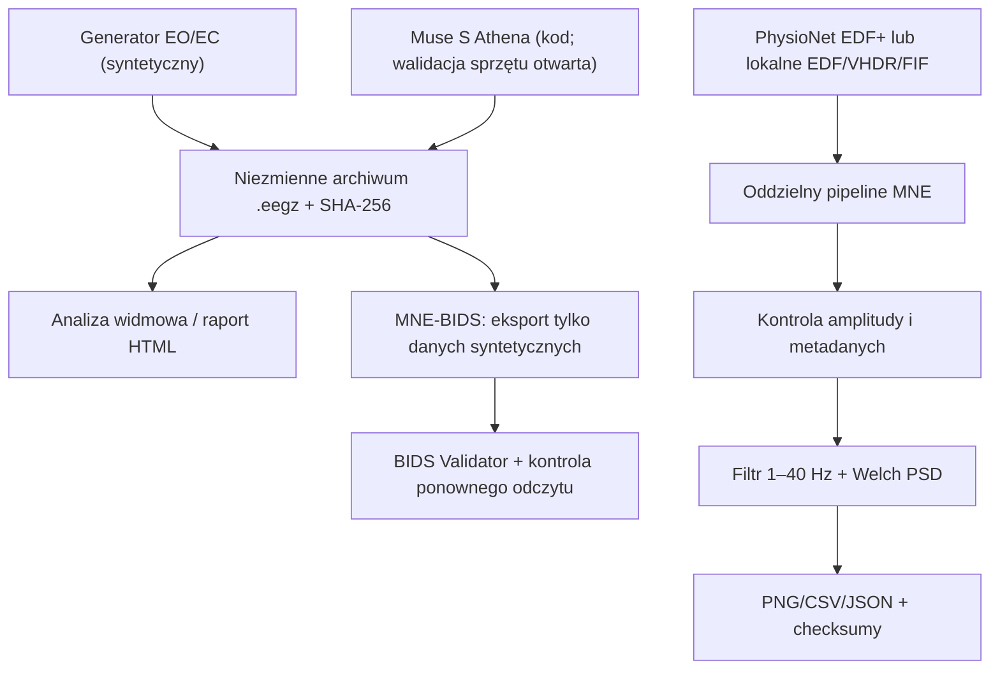

# Architektura akwizycji i analizy EEG

Projekt rozdziela **źródło danych**, zachowanie oryginalnego sygnału, przetwarzanie i publikację wyników. Dzięki temu nie mylimy działania aplikacji z wiarygodnością fizjologicznego pomiaru.

## Poziomy danych

| Warstwa | Przykład | Reguła integralności |
|---|---|---|
| Źródłowa | `.eegz`, EDF+, VHDR, FIF | Nie nadpisywać; zachować oryginalne próbki i dostępne znaczniki czasu |
| Metadane | jednostki, kanały, sampling, referencja, warunek EO/EC | Nie wymyślać nieznanych wartości |
| Kontrola jakości | spójność kanałów, przerwy, amplitudy, artefakty | Oddzielić flagowanie od automatycznego usuwania |
| Transformacje | filtr pasmowy, PSD Welcha | Ujawnić parametry, wersje, okna |
| Wynik | wykres PNG, tabela CSV, manifest JSON, raport HTML | Wskazać źródłowy SHA-256 i ograniczenia |

## Ograniczenia merytoryczne

Analiza mocy alfa 8–13 Hz nie jest diagnozą. Heurystyczny próg amplitudy nie usuwa automatycznie EOG/EMG. Dla PhysioNet porównujemy historyczne runy EO i EC, a nie wyniki własnego pomiaru. Dla Muse S Athena bramką pozostaje walidacja fizyczna.

Dalsze informacje: [realne EEG](real-eeg.md), [walidacja](quality.md), [architektura projektu](../architecture/PROJECT-CONCEPT.md).
